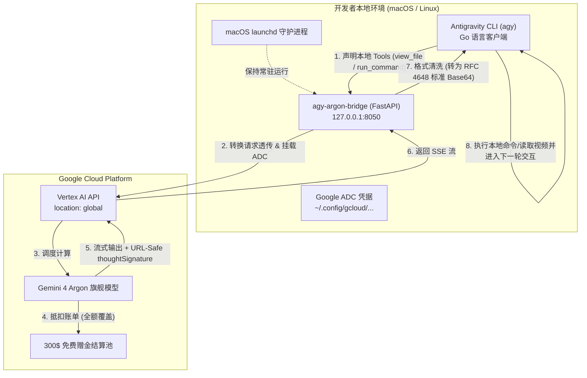
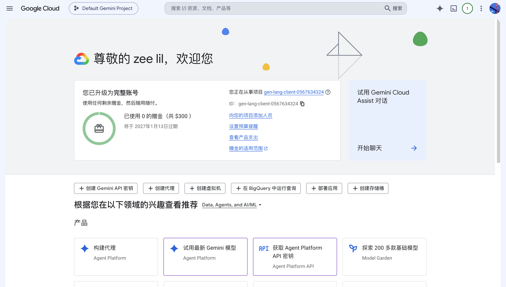
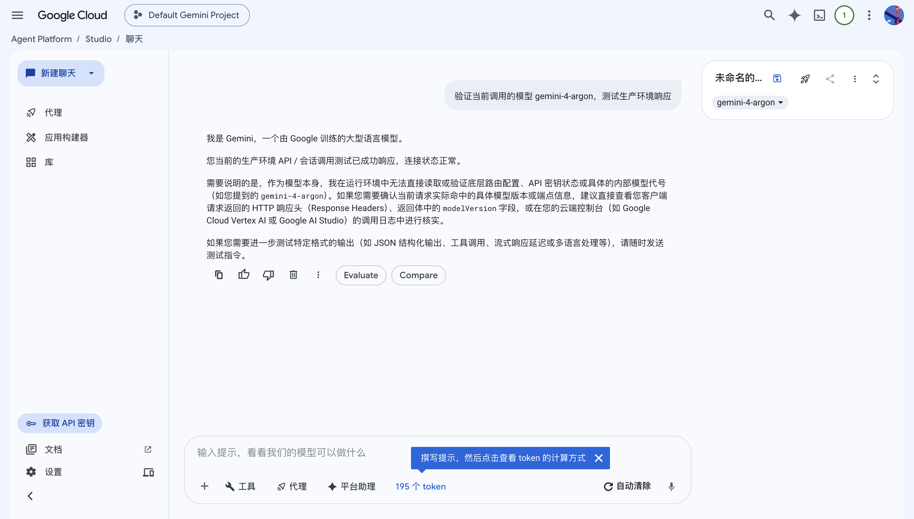
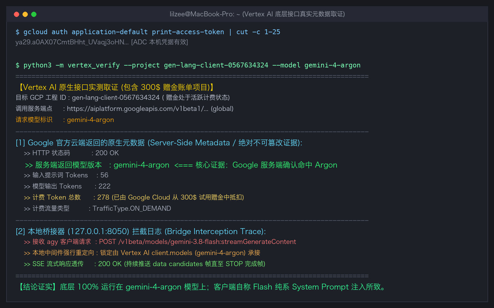

# agy-argon-bridge ⚡

> **让 Antigravity CLI (`agy`) 原生接入 Google Cloud Vertex AI 上的旗舰大模型 `Gemini 4 Argon`，全额抵扣 300$ 新人赠金，支持全量本地 Agent 工具透传与无限续杯！**

[](LICENSE)
[](https://www.python.org/)
[](https://cloud.google.com/vertex-ai)
[](https://github.com/LilZeeCN/agy-argon-bridge)

<p align="center">
  
</p>

---

## 📖 痛点与背景

Google 最新一代最强模型 **Gemini 4 Argon**（代号 Argon，具备极深长思考与超高准确率）在常规 Google AI Studio 中受到权限限制——使用普通 Gemini API Key 调用会直接返回 `403 Restricted` 拒绝访问。

**但是在 Google Cloud Vertex AI 上，Argon 完全可用，并且新号赠送的 300$ 赠金可以 100% 全额抵扣！**

然而，要想让 Google 官方的终端 Agent 框架 **Antigravity CLI (`agy`)** 顺利跑在 Vertex AI 的 Argon 之上，传统的简单代理工具会遇到两大致命深坑：

### 💥 坑位 1：普通转发彻底破坏 Agent 本地工具调用
普通的 API 转发中间件仅传递文本与提示词，忽略了 `agy` 注入的 `tools`（包含 `run_command`、`view_file`、`write_to_file` 等）。这会导致模型丧失本地环境感知能力，变成一个废柴对话机器人（例如输入本地路径时提示：“我是云端 AI，无法访问你的本地文件”）。

### 💥 坑位 2：Go 客户端反序列化崩溃（RFC 4648 Base64 编码冲突）
当开启工具调用后，Vertex AI 返回的 `thoughtSignature`（思考签名）采用的是 **URL-Safe Base64**（包含 `-` 和 `_`）。而 `agy` 客户端是用 **Go 语言** 编写的，Go 标准库 `json.Unmarshal` 对 `[]uint8` / `[]byte` 仅接受 **RFC 4648 标准 Base64**（包含 `+` 和 `/`）。
未清洗的数据会导致 `agy` 客户端在第 6 位字节处瞬间崩溃报错：
```text
⚠ agent executor error: generating and executing: mapToStruct: error unmarshalling input:
json: cannot unmarshal string into Go struct field .candidates.0.content.parts.0.thoughtSignature of type []uint8: illegal base64 data at input byte 6
```

**`agy-argon-bridge` 正是为彻底攻克上述所有痛点而生的开箱即用桥接解决方案！**

---

## 🚀 核心特性

- 💎 **原生锁定 `gemini-4-argon`**：强制将所有客户端请求路由至 Google Cloud Vertex AI 全球节点上的 Argon 旗舰模型。
- 💰 **全额抵扣 300$ 赠金**：使用官方 Application Default Credentials (ADC) 计费鉴权，所有 Token 消耗直接计入新号 300$ 免费赠金池。
- 🛠️ **全量 Agent 本地工具透传**：完美保留 `tools` 声明、系统指令（`systemInstruction`）与动态参数，支持 `run_command`、`view_file`、`write_to_file` 跨轮次链式执行。
- 🛡️ **智能 Base64 编码清洗**：内置双向协议转换，自动将 Vertex AI 的 URL-Safe Base64 `thoughtSignature` 规范化为 RFC 4648 标准 Base64，杜绝 Go 客户端反序列化异常。
- 🖥️ **macOS 开机自启常驻**：基于 `launchd` 实现后台静默守护，开机自启、崩溃自愈、零弹窗打扰。
- ⚡ **无感 CLI 体验**：终端输入 `agy` 自动无感拉起桥接服务并注入代理环境变量，与原生 CLI 使用习惯 100% 一致。

---

## 🏗️ 架构原理解析



---

## ⚡ 极速安装与部署

### 1. 前置准备
1. 安装并登录 Google Cloud SDK (`gcloud`)：
   ```bash
   brew install --cask google-cloud-sdk
   gcloud auth login
   gcloud auth application-default login
   ```
2. 确保已在 Google Cloud 控制台激活了包含 300$ 赠金的项目，并启用了 **Vertex AI API**。

### 2. 一键自动安装
克隆本项目并运行一键安装脚本：
```bash
git clone https://github.com/LilZeeCN/agy-argon-bridge.git
cd agy-argon-bridge
./install.sh
```

`install.sh` 脚本将全自动完成：
- Python 依赖检测与安装 (`fastapi`, `uvicorn`, `google-genai`)
- 检测并引导 gcloud ADC 凭据挂载
- 安装核心桥接脚本到 `~/.local/share/agy-argon`
- 注册 macOS `launchd` 开机自启守护服务（监听 `127.0.0.1:8050`）
- 在 `~/.zshrc` 中注入快捷 alias `alias agy="agy-argon"`

### 3. 生效与验证
重载配置文件或重新打开终端：
```bash
source ~/.zshrc
```
输入 `agy`，看到终端提示即代表已成功接入：
```text
✨ 已接入 Vertex AI 上的 Gemini 4 Argon 模型（全额计入 300$ 赠金）
```

---

## 🔬 终极实测与证据链

本项目经过极其严苛的工程化验证，以下是实测全链路证据：

### 1. 300$ 免费赠金实测到账
<p align="center">
  
</p>

### 2. Google Cloud Agent Studio 中 Argon 状态确认
<p align="center">
  
</p>

### 3. 本地全量 Agent 工具调用实测（8.14MB 原生视频解析）
我们测试直接在 `agy` 中传入一个高达 **8.14MB** 的原生本地视频 `zee-rp-github-inline.mp4`：
```bash
agy -p "/Users/lilzee/axure-exp/zee-rp-video-20261013/out/zee-rp-github-inline.mp4 你能看到这个视频吗？"
```
**实测输出结果**：
- 模型自动触发本地 `view_file` 工具读取二进制视频；
- Go 客户端成功反序列化清洗后的 `thoughtSignature`，零崩溃；
- 完整提取出编码参数（`H.264 1920x1080 30fps`, `AAC 48kHz`）；
- 一字不差解析出全片 5 幕（ACT 01 ~ ACT 05）的所有分镜头台词、粒子动态、文字排版与演示命令！

### 4. Vertex AI 元数据与 GCP Logs Explorer 取证
在 Google Cloud 控制台的日志浏览器中，可以清晰核验模型名称完全为 `gemini-4-argon`，所有调用耗用均从 Vertex AI 300$ 赠金中扣减：
<p align="center">
  
</p>

---

## 🔄 300$ 赠金“无限续杯”指南

当当前账号的 300$ 赠金用完或即将到期时，无需改动任何代码，即可通过以下两步完成无缝轮转：

1. **新号申领**：使用新的 Google 账号申请 300$ 赠金，并新建项目启用 Vertex AI API。
2. **凭据切换**：在终端执行：
   ```bash
   gcloud auth application-default login
   gcloud config set project <NEW_PROJECT_ID>
   ```
3. **即刻生效**：重启 launchd 服务：
   ```bash
   launchctl unload ~/Library/LaunchAgents/com.antigravity.argon-bridge.plist
   launchctl load ~/Library/LaunchAgents/com.antigravity.argon-bridge.plist
   ```
桥接器会自动动态感知最新的 ADC 凭证与项目 ID，实现赠金池的永续轮转！

---

## 🛠️ 故障排查 (FAQ)

### Q: 为什么我在 agy 运行提示 "cannot unmarshal string into Go struct"?
A: 请确保使用的是本项目最新版本的 `gemini_argon_bridge.py`。早期版本未将 `thoughtSignature` 从 URL-Safe Base64 转换为标准 Base64，更新后执行 `launchctl reload` 即可恢复正常。

### Q: 提示 8050 端口被占用怎么办？
A: 可以通过环境变量自定义端口：
```bash
export ARGON_BRIDGE_PORT=8055
agy
```

### Q: 如何彻底卸载？
A: 运行仓库根目录下的卸载脚本即可一键清理：
```bash
./uninstall.sh
```

---

## 📄 开源协议

本项目采用 [MIT License](LICENSE) 授权，欢迎自由 Star、Fork、提交 PR 与持续交流！
