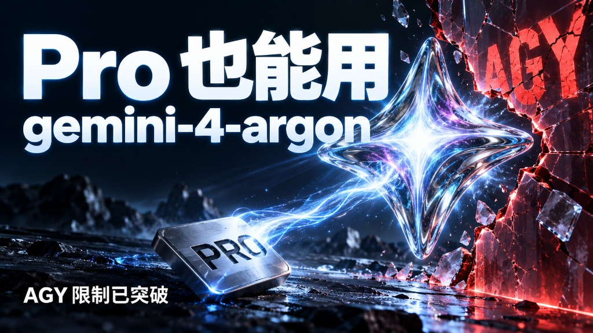
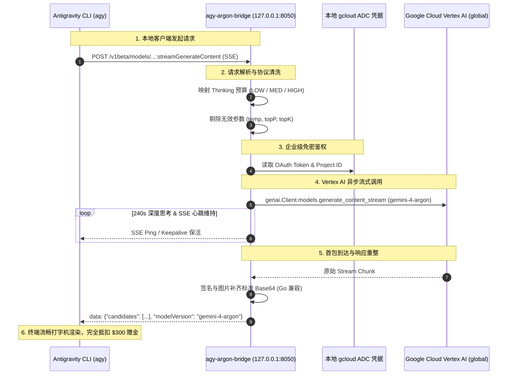
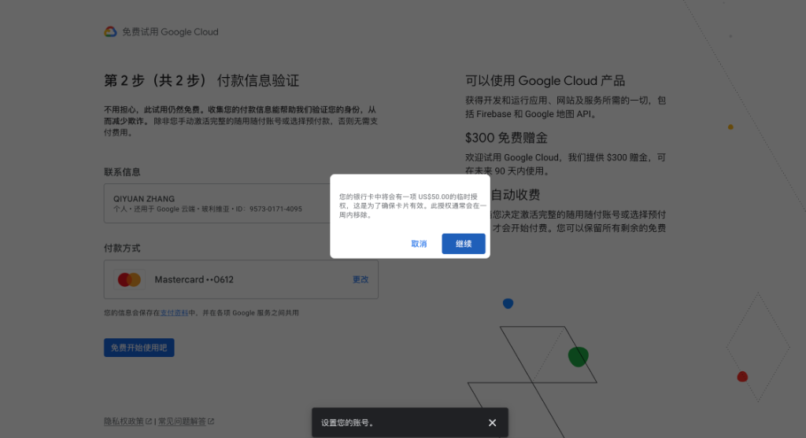
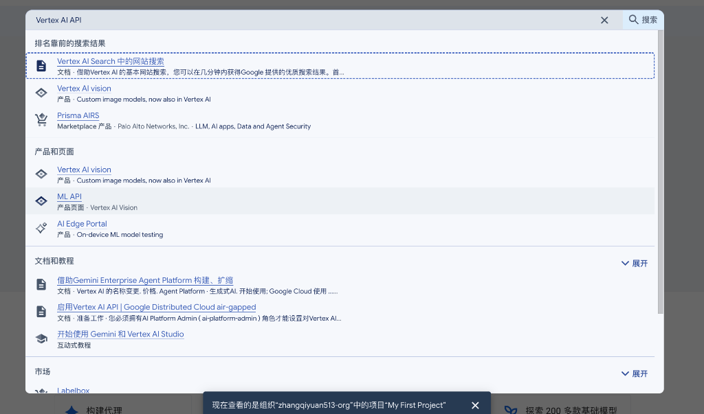
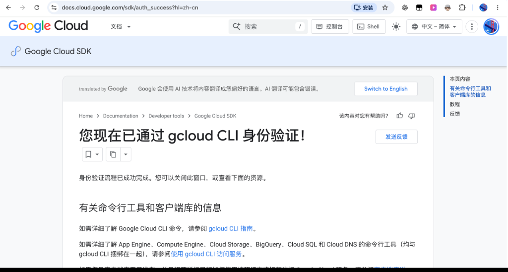

<div align="center">

# ⚡️ agy-argon-bridge

### 白嫖 Google Cloud $300 赠金 · 畅享 Vertex AI 旗舰 `gemini-4-argon` 本地高可用桥接服务

[](LICENSE)
[](https://www.python.org/)
[](https://cloud.google.com/vertex-ai)
[](https://cloud.google.com/vertex-ai)
[](https://github.com/LilZeeCN/agy-argon-bridge)

<br/>



</div>

<br/>

## 📖 目录

- [💡 为什么需要这个项目？](#-为什么需要这个项目)
- [🏗 架构与请求流转](#-架构与请求流转)
- [🎁 准备工作：云端环境与 300$ 赠金（图文教程）](#-准备工作云端环境与-300-赠金图文教程)
  - [1. 注册 Google Cloud 免费试用（关于 50$ 预授权的真相）](#1-注册-google-cloud-免费试用关于-50-预授权的真相)
  - [2. 启用 Vertex AI (Agent Platform) API](#2-启用-vertex-ai-agent-platform-api)
  - [3. 本地安装与配置 Google Cloud CLI (`gcloud`)](#3-本地安装与配置-google-cloud-cli-gcloud)
- [🚀 30 秒一键安装与运行](#-30-秒一键安装与运行)
- [🔍 验证真实云端模型返回](#-验证真实云端模型返回)
- [🎛 灵活切换模型（不仅是 Argon！）](#-灵活切换模型不仅是-argon)
- [🔄 核心技巧：300$ 赠金用完后如何“一键切号”？](#-核心技巧300-赠金用完后如何一键切号)
- [🛡️ 稳定性黑科技（v1.3.4 特性）](#️-稳定性黑科技v134-特性)
- [❓ 常见避坑与 FAQ](#-常见避坑与-faq)

---

## 💡 为什么需要这个项目？

Google 官方推出的 **Antigravity CLI (`agy`)** 是顶级的 Agentic 终端编程智能体，但默认配置下主要调用 `gemini-3.8-flash` 或需配置独立结算的 Google AI Studio。

与此同时，每个 Google Cloud 新账号都拥有 **$300 美元（有效期 90 天）的免费体验赠金**。很多开发者希望利用这 300$ 赠金，畅快调用 Google 最强多模态思考旗舰 **`gemini-4-argon`**，但在接入时会遭遇几大核心痛点：

1. **协议与鉴权断层**：`agy` 客户端只支持面向 AI Studio 的 API 格式，不支持 Google Cloud Vertex AI 的企业级 OAuth/ADC（Application Default Credentials）及项目/区域路由。
2. **长思考与大图多模态易中断**：带有高清图（例如 7 张截图、13 万+ Prompt Token）的大型任务，云端思考耗时可达 70~100s。普通代理因缺乏底层心跳维持，极易被客户端判定为超时死锁并强行掐断。
3. **网络抖动与 TCP 半开死锁**：开发者在切换 Wi-Fi 或代理时，操作系统底层的 TCP 会静默断开形成“半开死连接”，导致终端永久悬挂在 `Running command...`。
4. **Base64 反序列化兼容陷阱**：Vertex AI SDK 序列化图像与思考签名（`thoughtSignature`）时会生成 URL-Safe Base64，而 Go 编写的 `agy` 客户端仅接受标准 Base64，直接通信会导致 `illegal base64 data` 报错崩溃。

**`agy-argon-bridge`** 正是为解决上述所有痛点而生的本地企业级反向流式桥接服务：**零侵入、自动转换协议、240s 深度思考防断守护、心跳保活自愈、全自动抵扣 GCP 300$ 赠金！**

---

## 🏗 架构与请求流转



---

## 🎁 准备工作：云端环境与 300$ 赠金（图文教程）

### 1. 注册 Google Cloud 免费试用（关于 50$ 预授权的真相）

前往 [Google Cloud Free Trial](https://cloud.google.com/free) 注册并领取 **$300 赠金**。在绑定信用卡验证身份阶段，许多用户会被弹窗吓到：

<div align="center">
  
</div>

> [!TIP]
> **关于 US$50.00 临时授权的核心解答：**
> - **这不是扣款！** 它的本质是国际信用卡常见的 **“预授权冻结（Hold）”**，仅仅用来检验卡片是否真实且有可用额度。
> - **何时撤销？** Google 绝不会结算此款项。发卡行通常在 **1 ~ 7 个工作日内** 自动撤销该笔授权，额度全额恢复。
> - **会出账单吗？** **不会。** 未入账的预授权不会产生欠款，还款日完全不需要还这 50 刀。
> - 只要不主动升级完整随用随付账户，300 刀用完后服务只会**自动停机**，绝不会偷扣信用卡一分钱！

---

### 2. 启用 Vertex AI (Agent Platform) API

新创建的项目需要开通 Vertex AI API，否则调用时会报 `403 Permission Denied`。

1. 进入 [Google Cloud Console](https://console.cloud.google.com/)，在顶部确认已选中您的新项目。
2. 顶部搜索框输入 `Vertex AI API`（在最新版控制台中亦称为 **Agent Platform API**）：

<div align="center">
  
</div>

3. 点击进入后，点击醒目的 **“启用 (ENABLE)”** 按钮。当页面自动跳转到指标监控页面（Metrics）时，即代表 API 已就绪！

---

### 3. 本地安装与配置 Google Cloud CLI (`gcloud`)

确保您的电脑安装了 `gcloud`：

```bash
# macOS Homebrew 安装
brew install --cask google-cloud-sdk
```

接着在终端中执行关键的本地授权命令：

```bash
gcloud auth application-default login
```

- 终端会自动唤起浏览器打开 Google 登录页；
- 选择您已激活 300$ 赠金的 Google 账号并一路点击 **“允许 / Continue”**；
- 浏览器出现如下界面，代表本地凭据 `~/.config/gcloud/application_default_credentials.json` 已写入成功：

<div align="center">
  
</div>

---

## 🚀 30 秒一键安装与运行

克隆本项目并运行安装脚本：

```bash
# 1. 克隆仓库
git clone https://github.com/LilZeeCN/agy-argon-bridge.git
cd agy-argon-bridge

# 2. 设置您的 Google Cloud 项目 ID（在 GCP 顶部导航栏查看）
export GOOGLE_CLOUD_PROJECT="your-project-id"

# 3. 执行一键安装脚本
./install.sh
```

**`install.sh` 脚本会自动为您完成：**
- 在隔离目录 `~/.local/share/agy-argon/venv` 创建独立虚拟环境，绝不污染全局 Python；
- 安装 `google-genai`、`fastapi`、`uvicorn`、`httpx` 等所需依赖；
- 注册 macOS launchd 常驻守护服务 `com.antigravity.argon-bridge`（开机自启、奔溃自愈、后台常驻监听 `127.0.0.1:8050`）；
- 自动写入健康检查并自检服务可用性。

安装完成后，直接打开任意新终端运行 `agy` 即可！

---

## 🔍 验证真实云端模型返回

在终端运行内置的验证工具：

```bash
python3 bin/verify_argon.py
```

终端将打印类似如下的真实云端响应元数据：

```json
{
  "modelVersion": "gemini-4-argon",
  "responseId": "3APaaoGlKKGD9LsPufTigQM",
  "status": "200 OK",
  "trafficType": "ON_DEMAND"
}
```

> [!NOTE]
> 只要 `modelVersion` 显示为 **`gemini-4-argon`**，即证明所有推理均由 Google 最强多模态思考模型驱动，且计费已直接抵扣当前项目的 300$ 赠金。

---

## 🎛 灵活切换模型（不仅是 Argon！）

虽然本项目命名为 `agy-argon-bridge`，但其底层引擎天然支持 Vertex AI 托管的全系模型。只需更改 `TARGET_MODEL` 环境变量即可任意切换：

| 推荐模型 | 环境变量设置 | 核心特性与推荐场景 |
| :--- | :--- | :--- |
| **`gemini-4-argon`** *(默认)* | `export TARGET_MODEL="gemini-4-argon"` | 旗舰全模态深度思考模型，复杂工程架构重构、难题攻坚首选 |
| **`gemini-3.7-flash`** | `export TARGET_MODEL="gemini-3.7-flash"` | 最新混合思考极速版，消耗赠金极少，极适合高频日常打字交互 |
| **`gemini-3.1-pro-preview`** | `export TARGET_MODEL="gemini-3.1-pro-preview"` | 新一代高级推理预览版，逻辑和代码生成能力极强 |
| **`gemini-2.5-pro`** | `export TARGET_MODEL="gemini-2.5-pro"` | 工业级稳定性，支持 **200 万超大 Token 上下文窗口** |
| **`gemini-2.5-flash`** | `export TARGET_MODEL="gemini-2.5-flash"` | 极致性价比主力模型，毫秒级响应 |

**切换方法：**
修改 launchd plist 或在启动时声明 `TARGET_MODEL`，并重启服务：
```bash
launchctl kickstart -k gui/$(id -u)/com.antigravity.argon-bridge
```

---

## 🔄 核心技巧：300$ 赠金用完后如何“一键切号”？

当一个账号的 300$ 赠金用完或 90 天到期后，您可以轻松切换到新账号，继续白嫖 300 刀赠金。**完全不需要重装系统或重配环境，仅需 3 步：**

1. **新账号准备**：
   - 注册新账号并激活 300$ 赠金；
   - 在新项目内启用 `Vertex AI API`，记录新项目的 `Project ID`（如 `project-xxxxxx`）。
2. **终端重新授权**：
   ```bash
   gcloud auth application-default login
   ```
   在弹出的浏览器中登录新账号并点击允许。
3. **更新配置并热重载**：
   ```bash
   # 更新本地配额项目 ID
   gcloud auth application-default set-quota-project "YOUR_NEW_PROJECT_ID"
   
   # 修改 launchd 配置中的项目 ID 并重启
   sed -i '' 's|<string>OLD_PROJECT_ID</string>|<string>YOUR_NEW_PROJECT_ID</string>|g' ~/Library/LaunchAgents/com.antigravity.argon-bridge.plist
   launchctl bootout gui/$(id -u)/com.antigravity.argon-bridge
   launchctl bootstrap gui/$(id -u) ~/Library/LaunchAgents/com.antigravity.argon-bridge.plist
   ```
桥接器立即无缝切换至新账号，继续享受全新 300$ 赠金额度！

---

## 🛡️ 稳定性黑科技（v1.3.4 特性）

- **240s 深度思考长超时看门狗**：
  针对带有 7~10 张高清图的大型多模态 Agent 请求（耗时常在 60~100s），将超时阈值提升至 240s，彻底杜绝大模型还在构思就被本地过早切断的假死问题。
- **SSE 心跳与保活（Keepalive）**：
  在模型生成长思考 Token 期间，桥接服务每隔 20 秒向客户端主动下发保活帧，防止中间网关或客户端网络看门狗因“静默过久”触发连接掐断。
- **Go 标准库 Base64 补齐**：
  自动侦测 Python SDK 吐出的 URL-Safe Base64 并平滑修复补齐为标准 Base64，保障 Go 编写的客户端反序列化 100% 成功。
- **TCP 半开死锁自愈**：
  切网或切换代理时，网络连接被静默中断。桥接层捕获 EOF 与 Broken Pipe 信号并在 4 秒内无缝触发指数退避重试，免除人工重启困扰。

---

## ❓ 常见避坑与 FAQ

### Q1: 300$ 赠金能直接调用 OpenAI (GPT-6) 或 Anthropic Claude 吗？
> **答：不能。**  
> 虽然 Google Cloud 近期战略引入了 OpenAI（GPT-6 / Codex）与 Anthropic Claude 进入 Model Garden，但 Google 官方规则明确规定：**新用户 300$ 免费赠金只能用于抵扣 Google 自家第一方服务（Gemini / Imagen / Veo / Gemma 等）**。  
> 第三方 Partner 模型在试用期内会被配额锁定（Quota 0 / 403）。升级付费账号后虽可解锁 OpenAI/Claude，但调用会直接扣除信用卡现金，无法用赠金抵扣。因此，**薅赠金的最优解依然是全额抵扣的 Google 原生旗舰 `gemini-4-argon`**。

### Q2: 报错 `403 Permission Denied` 或 `API has not been used in project`？
> **答：** 请确认您在 Google Cloud Console 中为该项目开启了 **Vertex AI API (Agent Platform API)**。未启用的项目会被云端拒绝调用。

### Q3: 默认端口 8050 被占用怎么办？
> **答：** 指定自定义端口重新运行安装即可：
> ```bash
> export ARGON_BRIDGE_PORT=8055
> ./install.sh
> ```

---

## 📄 License

本项目基于 [MIT License](LICENSE) 开源。代码纯粹作为本地协议转换代理，实际模型可用性、访问配额及扣费情况以 Google Cloud 官方协议与账单为准。
